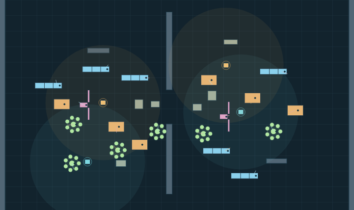
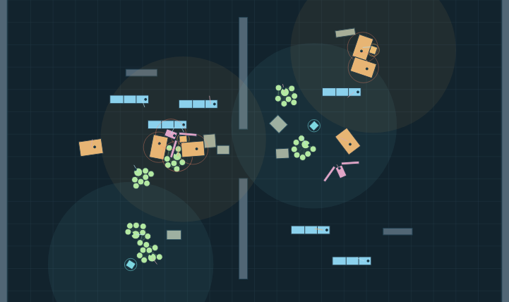

# W2 — integrated embodied material commons (experimental)

**Status:** new isolated experiment, not merged, not deployed, not Owner-qualified. W2 uses E1 as an explicit replaceable donor for the shared 44×27m Rapier2D world, independent local movement and permissive editor. B1 supplied the tested mechanical hypothesis and front-mounted self-colliding hinge geometry, reimplemented separately. No automatic E1+B1 architecture merger.

## Why
E1 shows local cue/contact-driven initiative with 18 heterogeneous bodies but no distinct changeable bodily action. B1 shows a three-part mass-bearing winged body that can fold and push, only as a prescribed solo corridor trial. **Question:** when real envelope articulation enters a crowded, editable E1-like world, does it create worthwhile, perceivable body/world possibilities rather than repeating traffic and button-triggered geometry?

## What the source contains
- Continuous editable E1-like world with 18 original local-effort bodies plus 2 self-colliding three-part foldable bodies, 4 movable odor emitters and distributed free matter. Operator may spawn foldables and narrow/wide cheap rigid equivalents.
- True physical hinge limbs: 85kg chassis + two 20kg limbs; paired bounded joint torque impulses, no scripted collider resize, connected self-contact ON. Operator Q/E or an experimental local pressure policy (last physical pressure/neighbor count with hysteresis) selects requested fold target. Neither control guarantees geometry against obstruction.
- Root movement of ALL residents remains the E1 finite planar artificial traction source, not feet or true reaction with physical ground. Finite heading assistance is explicit. Cue-local initiative is not vision, cognition or NPC desire.
- Old E1 source browser gate retained. New trials compare prescribed gated transit against constant rigid rivals; actual re-opening while confined; 20-actor shared-world rollout; real DOM add/fold/unfold/controls/reset. Cheap collision-aware shape morph is NOT implemented: even positive results cannot establish joints as superior.
- Main, public Pages and rehearsal/current remain unchanged.

## Initial falsifiers and Owner veto
- Jointed limbs fold on screen but create no practical continuation beyond size-class pathing.
- Local pressure policy just produces traffic, jitter or contacts without meaningful legible choice.
- A cheap physically collision-aware authored profile supplies the same useful actions with lower complexity/cost.
- Physical cost grows for no observable benefit.
- UI remains a solver demonstration rather than a world in which Owner spontaneously experiments.

Machine PASS applies only to the exact source test; Owner product verdict remains UNKNOWN. A failed W2 preserves scoped donor findings, not a foundation.

## Later causal red team and opportunity correction — 2026-10-11
One first W2 420-step world showed **real initiative and material movement but the new foldable organisms themselves hardly moved** (~0.63m and 0.68m). This was not evidence of a compelling combined world. A prespecified matched-placement sweep compared the original distant spawn, near-source spawn, and central-pressure spawn, manual target vs simple local policy. A separate clean approach (10,13.5) and (28,15) made the foldables traverse several metres and experience measurable material contacts; this is now the default *trial composition*, not an accepted scene.

**Crucial independent actuator-null:** same clean arrangement (two organisms, shared twenty-actor world, 420 genuine steps) produced identical world outcomes for policy MANUAL versus PRESSURE when both wing torque actuators were completely disabled. With cap=0 passive wings often compressed, despite no requested fold. With bounded actuators active, commanded changes produced different world afterstates under local pressure. This supports a narrow *actuator-to-physical consequence* dependency, not an autonomous decision advantage, natural muscle, or fun. For clean positions and actuator cap 3: manual vs pressure yielded foldable paths ~7.84/5.67m vs 4.65/4.98m, but no metric here says which is better. Repeated contacts are solver samples.

The initial intersection query returned 0 for sampled start configurations. **Caveat:** Rapier world scene queries may use a broad-phase snapshot that has not been updated after author repositioning; 0 is not asserted as a rigorous penetration-free start. A first policy command at tick 1 for some crowded settings warrants extra suspicion. Do not select those high-pressure settings just for bigger numbers. The new default clean setting's first automatic requested fold was tick 54, not tick 1, making it a more interpretable candidate. More exact geometry/first-contact validation still desirable.

New live source screenshot workflow samples exact ticks 0 / 180 / 420 from one emitted Chromium W2 solver with explicit causality/provenance, not a generated illustration and not a user feel test. Any visual impression is evidence with its own limits.

## First honest visual review — source-bound negative (2026-10-11)
**Raw Chromium/Rapier pixels** from source commit ed51f189c2f07b89c954931d7cbf61e50d646346 (CI #38095517077), one world with 20 agents and actual WASM fixed-step physics:
-  — initial independently directed actor and material distribution.
-  — genuine shared-world afterstate after 420 solver steps. Source frame also exists at t180 and the provenance logs record actual foldable geometry (t180 spans 1.9808/2.8495m; t420 spans 2.5992/1.8677m).

**Agent visual verdict: meaningful motion but NOT a compelling qualitative step.** The scene still communicates geometric blocks/beads, colored rings, proximity clustering and an attractor-style transit experiment. It does not visibly supply rich animal motion, deliberate body abilities, material verbs or a player-driven systemic world. Mechanical gate and command tests are green; product feel remains Owner UNKNOWN and historical R0/R1/L0 OWNER FAIL remains active. Do not interpret source snapshots as a new Owner playtest or any adoption of a final art style.

**Portfolio decision:** W2 should remain a replaceable source donor / early integrated counterexample, not an automatic parent of a new architecture. Next whole-level discovery should compete with W2 at the level of actual operator-discoverable actions, **not** tune its odor/pressure parameters until the screenshots are prettier. Body action + material opportunity + agency in a coherent world is still the broader question; W2 has not established that whole.
